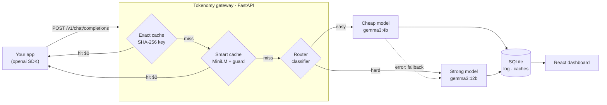

# Tokenomy

**A drop-in gateway that cuts a company's AI bill: __PCT__% cheaper on a 1,000-prompt benchmark, with __QUAL__% of answers judged as good as the strong model's.**

Companies pay for every LLM request, but many requests are **repeats**, **paraphrases** or **easy questions** sent
to an expensive model, and nobody can see where the money goes. Tokenomy sits between your app and the models
(local [Ollama](https://ollama.com) or [OpenRouter](https://openrouter.ai)), speaks the OpenAI API, and fixes all four:

| | What it does | Cost |
|---|---|---|
| **Exact cache** | Same question again → stored answer | $0 |
| **Smart cache** | Same *meaning* ("India's capital city?") → stored answer, protected by a key-facts guard | $0 |
| **Smart router** | Easy prompt → small cheap model, hard prompt → strong model (96%-accurate classifier) | less |
| **Dashboard** | Live spend, savings, hit rate, latency, per-model usage, request log, playground | — |

Using it is a **one-line change**:

```python
from openai import OpenAI
client = OpenAI(base_url="http://localhost:8000/v1", api_key="unused")   # ← the only change
client.chat.completions.create(model="tokenomy/auto", messages=[{"role": "user", "content": "How do I reset my password?"}])
```


## Benchmark

1,000 prompts that look like real customer-support traffic for an online store (`benchmark/prompts.jsonl`):
70% FAQ questions with repeats and human paraphrases, 15% easy requests, 15% hard ones (planning, maths, code).
**A** sends everything to the strong model (`gemma3:12b`); **B** sends everything to `tokenomy/auto`.

__RESULTS_TABLE__

Prices are OpenRouter's public list prices for the same open models (`scripts/update_pricing.py`).
Quality: `gemma3:12b` compares Tokenomy's answer with its own answer, blind and in random order, on a random sample.
Full report: [`benchmark/results.md`](benchmark/results.md). Reproduce with `python benchmark/run.py`.

## Architecture



**Why these choices** (more in [`docs/INTERVIEW.md`](docs/INTERVIEW.md)):
- **Only low-temperature requests are cached.** High temperature means "give me variety"; replaying one answer would break that.
- **Similarity alone is not enough.** "Flights **to** Delhi **from** Mumbai" vs "flights **from** Delhi **to** Mumbai" scores **0.992**,
  higher than real paraphrases. A key-facts guard (numbers, days, names, to/from, opposite verbs) cut wrong hits from 2/8 to **0/8**
  in `scripts/tune_threshold.py`, which let the threshold drop to 0.85 and catch more real paraphrases.
- **The cache is scoped** by model and system prompt, and the smart cache only handles single-turn questions.
- **The router** blends a logistic-regression classifier on embeddings (96% held-out accuracy) with simple rules, and falls back to
  the strong model if the cheap one errors.

## Quick start

```bash
# 1. free local models
ollama pull gemma3:4b && ollama pull gemma3:12b
# 2. gateway
python -m venv .venv && .venv/Scripts/pip install -r requirements.txt   # (Linux/mac: .venv/bin/pip)
cp .env.example .env
.venv/Scripts/python -m uvicorn tokenomy.app:app --app-dir src --port 8000
# 3. open http://localhost:8000  (dashboard)   ·   python examples/client.py
```

Or with Docker: `docker compose up`, then `docker compose exec ollama ollama pull gemma3:4b` (and `gemma3:12b`).

## API

| Endpoint | |
|---|---|
| `POST /v1/chat/completions` | OpenAI-compatible. `model`: `tokenomy/auto`, `ollama/<name>`, or any OpenRouter id. `stream: true` works. |
| `GET /v1/models`, `GET /health` | |
| `GET /stats`, `/stats/timeseries`, `/stats/models`, `/requests` | Dashboard data |
| `GET /router/explain?prompt=…` | Why a prompt is easy or hard |

Request header `X-Tokenomy-Cache: skip` bypasses the cache. Response headers: `X-Tokenomy-Cache-Status`
(`miss` / `exact_hit` / `semantic_hit`), `X-Tokenomy-Model`, `X-Tokenomy-Route`, `X-Tokenomy-Similarity`, `X-Tokenomy-Cost-USD`.

## Configuration (`.env`)

| Variable | Default | |
|---|---|---|
| `OPENROUTER_API_KEY` | — | Optional; free key from openrouter.ai |
| `ROUTER_CHEAP_MODEL` / `ROUTER_STRONG_MODEL` | `ollama/gemma3:4b` / `ollama/gemma3:12b` | |
| `ROUTER_MODE` | `classifier` | or `rules` |
| `SEMANTIC_THRESHOLD` | `0.85` | Tune with `scripts/tune_threshold.py` |
| `CACHE_MAX_TEMPERATURE` | `0.3` | |
| `CACHE_TTL_SECONDS` | `86400` | |

## Development

```bash
.venv/Scripts/python -m pytest -q          # 25 offline tests (fake upstream, no downloads)
cd dashboard && npm install && npm run dev  # dashboard with hot reload on :5173
python scripts/train_router.py              # retrain the router (prints accuracy)
```

CI (GitHub Actions) runs the tests, builds the dashboard and builds + smoke-tests the Docker image on every push.

## Limitations & next steps
- The smart cache is single-turn only; long conversations use the exact cache.
- Cache misses are not token-streamed yet (the full answer is sent as one SSE stream).
- The quality judge is an LLM; a human review of the sample would make it stronger.
- To scale: Redis for the exact cache, a vector DB for embeddings, async logging, many stateless workers.

Built by [Siddharth Bhat](https://siddharthbhat120.github.io) · MIT licence
